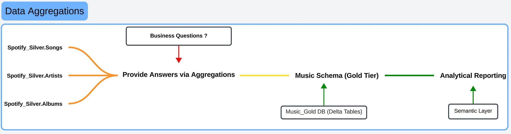
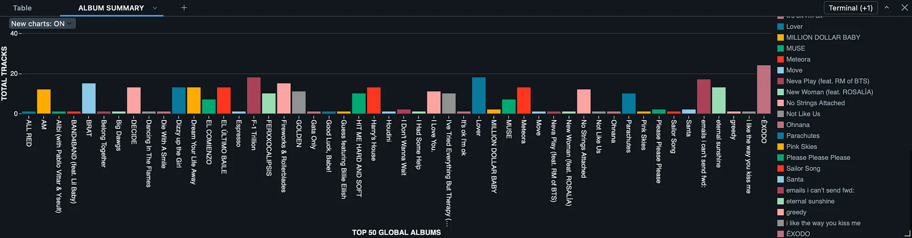
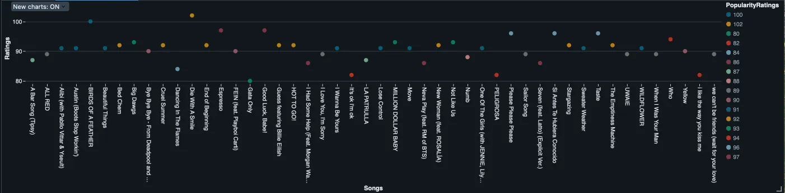

# 🎧 Spotify Lakehouse Integration

[](https://github.com/patrickokare/spotify-lakehouse-portfolio-project/actions/workflows/ci.yml)

A Medallion-architecture lakehouse on **Databricks + Delta Lake** that pulls a Spotify playlist from the Web API every day and turns it into clean, reportable tables for songs, albums and artists.

> 📍 Source: Spotify Web API (playlist tracks)  
> 🧱 Layers: Landing → Raw → Cleansed → Modelled  
> ☁️ Platform: Azure Databricks, ADLS, Key Vault, Delta Lake, Asset Bundles

---

## Storytelling
Medium blog: [The Medallion Architecture: Spoti-py case study](https://karetech.medium.com/the-medallion-architecture-spoti-py-case-study-the-lake-house-model-the-beginning-822db0372feb)

---

## 🧱 Architecture


| Layer | Schema | Contents |
|---|---|---|
| **Landing** | ADLS folder | Raw API response, one JSON file per run |
| **Raw** | `spotify_raw` | Albums, artists, songs from every run (append-only history) |
| **Cleansed** | `spotify_cleansed` | One current row per album / artist / song (`MERGE`, change detection with `HASH_ID`) |
| **Modelled** | `spotify_modelled` | `SongsPopularityAgg`, `AlbumSummaryAgg`, `ArtistSummaryAgg` |

More detail: [architecture](docs/architecture.md) · [runbook](docs/runbook.md)

---

## 📁 Project Structure

```bash
├── databricks.yml              # Databricks Asset Bundle (dev / prod)
├── resources/                  # Jobs: setup + daily load
├── src/
│   ├── spotify_lakehouse/      # Python package: config, API parsing, transforms, data quality
│   └── notebooks/
│       ├── 00_setup/           # Schemas and tables
│       ├── 01_ingestion/       # API -> landing, landing -> raw -> cleansed
│       ├── 02_modelled/        # Reporting tables
│       └── 03_quality/         # Post-load data quality checks
├── schema/                     # DDL (raw, cleansed) and reporting queries (modelled)
├── tests/                      # pytest unit tests
├── docs/                       # Architecture, runbook, diagrams
└── .github/workflows/          # CI (lint, tests, bundle validate) + deploy
```

---

## 🚀 Run it

```bash
pip install -r requirements-dev.txt
ruff check . && pytest                       # same checks as CI

databricks bundle deploy -t dev
databricks bundle run spotify_setup -t dev         # once
databricks bundle run spotify_daily_load -t dev
```

Spotify credentials are read from a Key Vault-backed secret scope - see the [runbook](docs/runbook.md).

---

## 📊 Key Features

- **One API call per run** - the playlist is landed once and parsed into three entities
- **Pagination and retries** - handles playlists over 100 tracks and transient API errors
- **Tested parsing** - removed tracks, partial release dates (`"2019"`) and multi-artist tracks are covered by unit tests
- **Incremental upserts** - cleansed tables only update rows whose content changed
- **Data quality gates** - each batch is checked before it reaches cleansed; the full model is checked after every run (nulls, duplicates, ranges, song → album/artist relationships)
- **CI/CD** - GitHub Actions runs lint + tests on every push; Databricks Asset Bundles deploy the jobs

---

## 📈 Insights



- Which songs are the most popular right now, and how does that change day to day (raw history)?
- Which albums and artists have the most tracks in the playlist?
- How long are the top songs?




---

## 🔐 Security

- Spotify credentials in Azure Key Vault, read through a Databricks secret scope
- No secrets in code or job definitions
- Source system and source file recorded on every row for traceability

---

## 🚀 Future Enhancements

- Track several playlists (metadata table of playlist ids)
- Daily popularity snapshot fact for trend analysis
- Real-time ingestion via Event Hubs / Auto Loader
- Move from DBFS mounts to Unity Catalog volumes

---

## 🧑‍💻 Author

**Patrick Okare**  
Certified Azure Data Engineer | Lead Data Engineer | Building Lakehouses with Purpose  
[LinkedIn](https://www.linkedin.com/in/patrickokare/)

## 📝 License

MIT - see [LICENSE](LICENSE).
