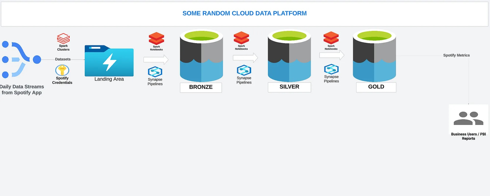
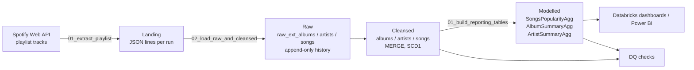

# Architecture

## Layers

| Layer | What it holds | How it is written |
|---|---|---|
| Landing | Exactly what the API returned, one JSON line per playlist item | New file per run, never overwritten |
| Raw (`spotify_raw`) | Parsed albums, artists and songs from every run | Append - lets you see how popularity changed over time |
| Cleansed (`spotify_cleansed`) | One current row per album / artist / song | `MERGE`; only rows whose `HASH_ID` changed are updated |
| Modelled (`spotify_modelled`) | Reporting tables | Rebuilt each run (`CREATE OR REPLACE TABLE ... AS SELECT`) |

## Design choices

- **One API call per run.** The extract task lands the playlist once; albums, artists and songs are all parsed from that file. The original version called the API three times.
- **Parsing is plain Python.** `parsing.py` has no Spark dependency, so the tests run in milliseconds and cover the awkward API cases (removed tracks, `"2019"` release dates, multiple artists).
- **Stable change detection.** `HASH_ID` only covers business columns. Load metadata (ingestion time, file name) is excluded so unchanged rows are not rewritten every day.
- **Secrets stay in Key Vault.** The notebook reads them through a Databricks secret scope.
- **Quality gate before cleansed.** Each batch is checked (nulls, duplicates, ranges) before the MERGE, and the whole model is checked after every run, including song -> album / artist relationships.

## Repo layout

| Folder | Purpose |
|---|---|
| `src/spotify_lakehouse/` | Config, API parsing, Spark helpers, data quality checks |
| `src/notebooks/` | Databricks notebooks, numbered in run order |
| `schema/` | Table DDL and reporting-table queries |
| `resources/` | Databricks jobs (Asset Bundle) |
| `tests/` | Unit tests (pytest + local Spark) |
| `.github/workflows/` | CI and manual deploy |
